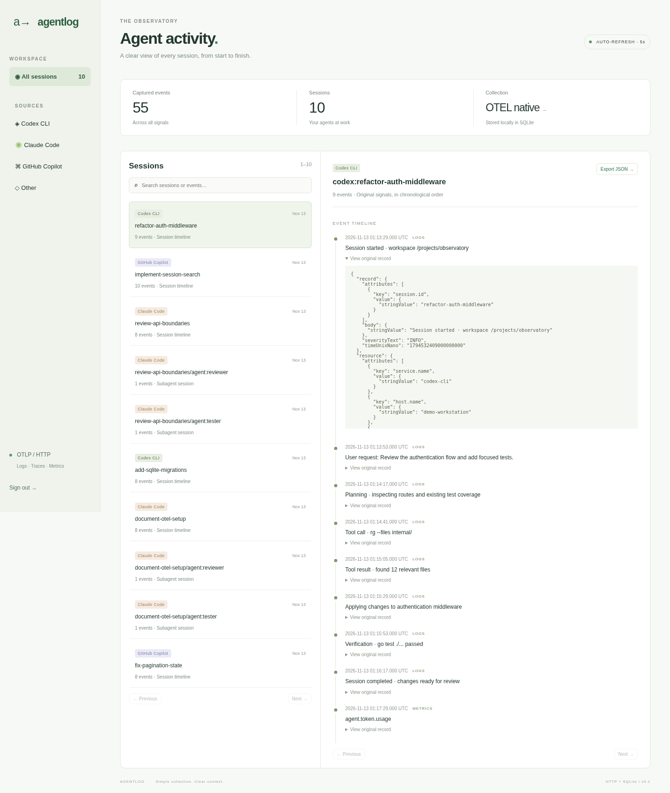

# Agentlog

A small, personal OpenTelemetry collector and session viewer for Codex CLI, Claude Code and GitHub Copilot CLI. One Go binary, an embedded web UI, and SQLite. Send telemetry from multiple machines to a central instance.



## Run

Download an archive from [Releases](https://github.com/sasakiy84/agent-log-collector-and-viewer/releases), verify its SHA-256 against `checksums.txt`, and extract it. All six Linux/macOS/Windows × amd64/arm64 builds use `CGO_ENABLED=0`.

```sh
# Generate a random token, then store it in your service manager's secret configuration.
export AGENTLOG_TOKEN="$(openssl rand -hex 32)"
./agentlog --listen 127.0.0.1:4318 --db ./agentlog.db --retention-days 30
```

Open http://127.0.0.1:4318 and sign in with the token. `AGENTLOG_TOKEN` must be at least 16 characters. The same token authorizes OTLP ingestion and viewing; this is a single-user tool. Browser login issues an HttpOnly, SameSite=Strict cookie valid for 12 hours. Ingestion accepts only `Authorization: Bearer TOKEN`, never the viewing cookie. Rotating the token and restarting invalidates existing sessions.

Use an HTTPS reverse proxy for central deployment. Bind the collector to loopback and expose only the proxy. A Caddy example (replace the domain, ensure DNS points to the server):

```caddyfile
agents.example.com {
    reverse_proxy 127.0.0.1:4318
}
```

Caddy supplies `X-Forwarded-Proto: https`, causing secure cookies. Do not expose the upstream directly or trust forwarded headers from untrusted clients. There is no built-in TLS. For a service, set a private working directory, a restrictive umask (077), restart on failure, and store the token outside your repository. Logs and prompts may contain private data. The token is shared across machines; restrict access to trusted devices and add proxy rate limits if exposing the login endpoint publicly.

## Configure senders

Examples below target `https://agents.example.com`. Replace the placeholder token with the server token. Per-signal OTLP endpoints include `/v1/logs`, `/v1/traces` or `/v1/metrics`; generic OTLP environment endpoints use the base URL. Check your installed CLI version: available signals and fields vary. These examples were checked against the linked official references; end-to-end testing here uses synthetic OTLP rather than authenticated real CLI runs.

### Codex CLI

In `~/.codex/config.toml` (merge with your existing `[otel]` table):

```toml
[otel]
log_user_prompt = false
exporter = { otlp-http = { endpoint = "https://agents.example.com/v1/logs", protocol = "binary", headers = { "Authorization" = "Bearer REPLACE_WITH_TOKEN" } } }
trace_exporter = { otlp-http = { endpoint = "https://agents.example.com/v1/traces", protocol = "binary", headers = { "Authorization" = "Bearer REPLACE_WITH_TOKEN" } } }
```

Codex uses `binary`/`json` for the HTTP protocol configuration, rather than the standard environment variable spellings. Keep configuration permissions private because these headers contain your token. Metrics export configuration depends on Codex version; start with logs and traces above. See [Codex configuration reference](https://developers.openai.com/codex/config-reference).

### Claude Code CLI

Set these in the launching shell or user settings, rather than repository-local settings:

```sh
export CLAUDE_CODE_ENABLE_TELEMETRY=1
export OTEL_METRICS_EXPORTER=otlp
export OTEL_LOGS_EXPORTER=otlp
export OTEL_EXPORTER_OTLP_PROTOCOL=http/protobuf
export OTEL_EXPORTER_OTLP_ENDPOINT=https://agents.example.com
export OTEL_EXPORTER_OTLP_HEADERS="Authorization=Bearer REPLACE_WITH_TOKEN"
```

Recent Claude versions also offer beta traces with `CLAUDE_CODE_ENHANCED_TELEMETRY_BETA=1` and `OTEL_TRACES_EXPORTER=otlp`. Prompt capture is opt-in; enable it only if you want this server to retain that content. Metrics without session attributes appear under `unassigned:claude`. See [Claude monitoring reference](https://code.claude.com/docs/en/monitoring-usage).

### GitHub Copilot CLI

```sh
export COPILOT_OTEL_ENABLED=true
export OTEL_EXPORTER_OTLP_ENDPOINT=https://agents.example.com
export OTEL_EXPORTER_OTLP_PROTOCOL=http/protobuf
export OTEL_EXPORTER_OTLP_HEADERS="Authorization=Bearer REPLACE_WITH_TOKEN"
```

Use HTTPS with Copilot. Its documented signals are traces and metrics; content capture defaults off. This example refers to the CLI runtime, whose default service name is `github-copilot`, rather than the separate VS Code extension telemetry. See [Copilot OpenTelemetry reference](https://github.com/github/docs/blob/main/content/copilot/reference/enterprise-administrators/opentelemetry-reference.md).

## What is stored and displayed

- `POST /v1/logs`, `/v1/traces`, `/v1/metrics`: OTLP/HTTP JSON and Protobuf, optionally gzip; gRPC is not supported. Responses use the request encoding. Accepted batches commit in one SQLite transaction before success.
- Up to 16 MiB compressed and decompressed per request, 16 MiB of normalized event data, and 10,000 normalized records. Unknown protobuf JSON fields are ignored for compatibility. Invalid input is rejected. Identical normalized records are deduplicated by SHA-256; telemetry without distinct timestamps may collapse if otherwise identical.
- Resource, instrumentation scope and records are retained in decoded OTLP form. IDs export as hex. Metrics are separate datapoint events with metric metadata; cumulative samples are never summed. Binary encoding, unknown protobuf fields, empty resource groups and resource/scope dropped-attribute counters are not preserved byte-for-byte.
- Sources are inferred from `service.name` or instrumentation scope containing `codex`, `claude` or `copilot`; customized names without these strings appear as Other.
- Recognized session attributes: `session.id`, `conversation.id`, `gen_ai.conversation.id`, `session_id`. IDs are namespaced by source, not machine. Reusing the same session ID across machines intentionally combines their data.
- Claude `agent_id` splits a session into agent timelines. `parent_agent_id` links nested agents; per the Claude schema, its absence on a subagent means the parent is the main session. Parent links can exist before parent data arrives.
- A record with no session ID falls back to `trace:SOURCE:TRACE_ID`, or `unassigned:SOURCE` when no trace exists. Across batches, trace records move into an explicitly identified session when the parent span matches or the trace has exactly one known session. Ambiguous traces stay separate. Trace parent links appear in the timeline; targets outside the current event page require navigating to that page. No relationships are inferred from text or timing.
- Sessions and events paginate in groups of 200. Search matches session IDs and event names; displayed counts and dates reflect matching events. The viewer polls every 5 seconds and retains expanded raw records. Export downloads all stored events for the selected session as JSON; large sessions can require substantial memory.
- Default retention is 30 days since receipt, pruned at startup and hourly; `--retention-days 0` disables expiry. Retention applies to server receipt time, including old imported events. Database pages may retain deleted data until SQLite reuses them. Stop the service before copying the database and its WAL files, or use SQLite's online backup API. Keep the database on a local filesystem and run one collector process per database.

No local session-log import, hooks, forwarding, arbitrary processors/exporters, multi-user roles, full-text index, or vendor-specific dashboard aggregations are included.

## Build, test and demo

Requires Go 1.25 or newer (the module toolchain may select a newer Go version), Python 3 for demo/browser scripts (browser checks additionally need Playwright and Chromium), and zip/tar for release packaging.

```sh
go test -race ./...
go vet ./...
go build -o agentlog ./cmd/agentlog
# Start the collector, then in another terminal with the same token:
python3 scripts/demo.py
# Cross-build and package all six targets:
scripts/release.sh v0.1.0
```

The screenshots contain **synthetic demo telemetry**, sent through the HTTP receiver by `scripts/demo.py`; they are not real agent sessions. See [mobile screenshot](docs/mobile.png) and [validation notes](docs/validation.md). The UI has no external font, script or CDN dependency.

CI runs formatting checks, race tests, vet, and all six cross-builds. Pushing a `v*` tag runs the release workflow, creates archives and checksums, and publishes them to GitHub Releases.

MIT licensed. Dependencies retain their own licenses.
