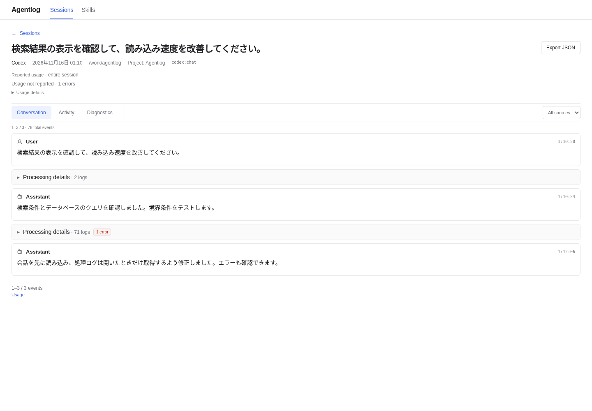

# Conversations and processing logs

Session timelines open at the latest **Conversation**: human inputs and assistant
messages, including intermediate assistant explanations, in chronological order.
**Processing details** between messages start collapsed. Expanding a group loads
up to 50 logs; **Load more logs** fetches the next batch. Closed groups show error
counts, and clicking an error count opens just those errors. **Include diagnostics**
adds internal telemetry. Reopening a loaded group reuses its loaded cards.
Group counts follow the diagnostics toggle; diagnostic-only records do not inflate
the normal processing count.

*Synthetic telemetry.*

Copilot root agent envelopes provide the conversation; child model spans and
delegated tasks stay in processing logs to avoid repeating input histories.

Conversation pages count conversation entries, not hidden logs. The ranges before
the first message, between messages and after the last message remain accessible,
including across page boundaries. Ranges describe chronological placement, not
inferred turn ownership. Missing answers are labeled as unrecorded, never assumed
to be running. Sessions with no conversation text still offer their processing logs.

Search includes closed logs. Opening a search result retains its search conditions;
a matching-log button opens the relevant group with those filters applied. Original
JSON and tool input/output links remain in the individual event's side panel.

**Activity** retains actual tools, subagents, skills and failures. **Diagnostics**
also includes internal spans, preparation, transport and metrics. Event-type and
origin filters are applied on the server before pagination in these views.

When explicit turn and trace ancestry identify a completed model call, its model,
reported tokens, cache reads and duration appear beneath the latest assistant
message in that turn in **Activity**, and in its event details. Click the summary
for call details and original JSON. Whole-session usage and skill totals include
closed processing logs.
Related response totals replace previous reports rather than being added together.
At most 100 summaries are shown for one reply; Diagnostics retains every event.
Without sufficient identifiers, session totals remain available without attributing
them to a particular answer. Missing prompt or project data is never fabricated.

Session titles use the first user request, skipping recognized Codex context and
`<external_codex_apps_open_page>` and numbered
`<external_codex_apps_selected_page_part_N_of_M>` application messages. Only
complete leading envelopes with matching tags are stripped; a quoted discussion
or incomplete tag remains an ordinary request. Codex approval-review and
next-message suggestion templates are also excluded from titles; conversations
containing only these automatic requests are hidden by default. Enable **Internal
sessions** to inspect them. Original messages remain available in the
processing logs, JSON export and search.

`guardian_scoring_observation` and spans from `codex_guardian_v2` are internal
Guardian observations. A contextual `tool_name` or `call_id` does not make them
tool output. They stay in Diagnostics, do not count as tool executions, and cannot
pair with real tool inputs/outputs. Their displayed duration is the observation
span's duration. `codex.guardian_assessment` is a separate assessment event; when
provided, its outcome, risk, authorization and rationale are shown.

Native Codex tool spans such as `exec` or `exec_command` that carry only timing
and contextual IDs appear as **Tool execution timing** in Diagnostics. A completed
span does not prove that output was recorded. Timing-only spans cannot pair with
real tool input/output records. Spans containing actual tool content stay visible;
failures remain accessible with diagnostics disabled.

Existing databases receive versioned migrations and a resumable presentation
backfill after HTTP startup. Original event IDs and OTLP payloads are preserved.
The conversation/Guardian repair visits bounded cached presentations and reparses
only candidate Guardian/tool spans, empty-title Codex user records and old Copilot
agent envelopes. Completed jobs do
not run again. Ordinary timeline requests use indexed cards; initial conversation
requests read only conversation bodies and processing counters.
