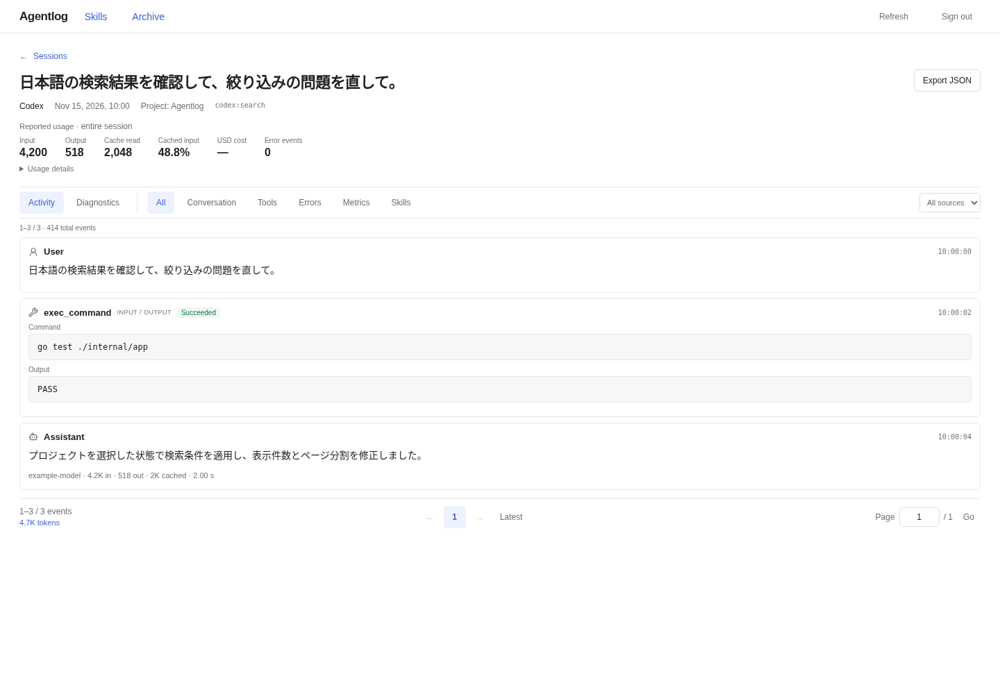

# Activity and diagnostics

Session timelines open at the latest **Activity**: user messages, assistant text,
actual tool calls/results, subagents, skill use and flagged failures. **Diagnostics**
also includes internal Codex spans, preparation, transport events and metrics.
Type/origin filters and page counts are applied on the server before pagination.
Changing a filter opens the latest matching page; entries remain chronological.

*Synthetic telemetry.*

When explicit turn and trace ancestry identify a completed model call, its model,
reported tokens, cache reads and duration appear beneath the latest assistant
message in that turn. Click the summary for call details and original JSON.
Related response totals replace previous reports rather than being added together.
At most 100 summaries are shown for one reply; Diagnostics retains every event.
Without sufficient identifiers, session totals remain available without attributing
them to a particular answer. Missing prompt or project data is never fabricated.

Existing databases receive versioned migrations and a resumable presentation
backfill. Original event IDs and OTLP payloads are preserved. Imported cards use
their bounded cached presentation; native OTEL records are parsed once during the
upgrade to correct classification and build call statistics. Ordinary timeline
requests use indexed cards, not raw payload scans.
