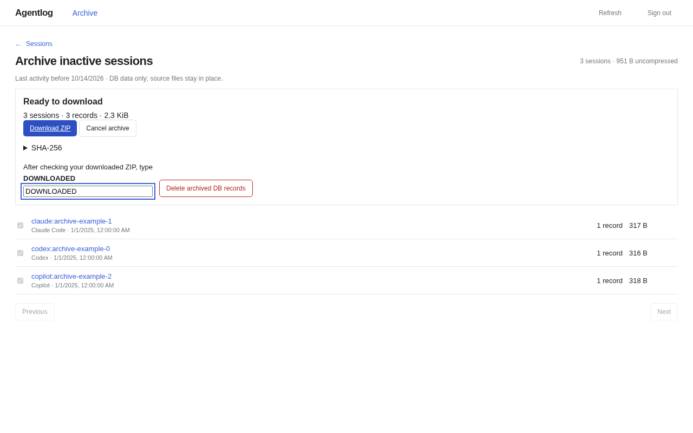

# Archive

1. Open **Archive**. Sessions whose last recorded activity is over one calendar month old appear here. Sessions with unknown timestamps are excluded.
2. Select sessions, or **Select all inactive sessions**, then **Create ZIP**. Use **Refresh** to check job progress.
3. **Download ZIP**, check the local file, then type **DOWNLOADED** and choose **Delete archived DB records**.

Downloading alone never deletes records. Updated sessions require a new archive. Canceling keeps DB records. Source files stay in place; identical archived records are ignored on reimport, while new or changed records can be imported.

ZIP files contain `manifest.json`, a `sessions.jsonl` index, and one JSONL per session with all stored originals, including imported and OTEL records. These are Agentlog records, not the CLI's native import format. The UI shows a SHA-256 checksum.

Archives are built under `archives/` beside the database, streamed to disk, and downloaded directly with HTTP range support. Allow disk space for the compressed ZIP. The server copy is removed after download confirmation and integrity verification. Confirmed deletion resumes after a restart; interrupted ZIP creation must be retried.

New databases return free pages to disk automatically in small batches, allowing ingestion between batches. On failure, freed pages remain reusable; free disk space and use **Retry compaction**.

Existing databases first keep freed pages available for reuse. To return this space to disk, choose **Rebuild database · pauses ingestion**. This one-time SQLite rebuild can require up to twice the database size in free space; clients should retry ingestion until it finishes. Subsequent archives use incremental reclamation.
