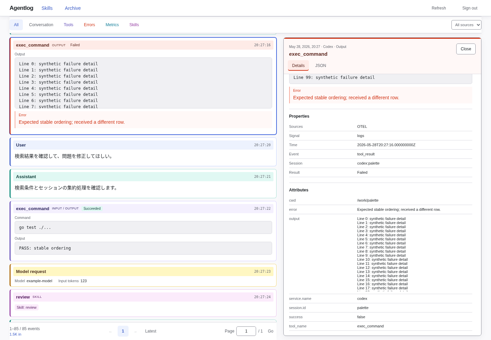

# UI colors

Agentlog uses the light sRGB scales from [Radix Colors](https://www.radix-ui.com/colors), pinned to [dbdb854](https://github.com/radix-ui/colors/tree/dbdb85470547c7d34b9001f48fddb08ded335979). The original MIT license is included in `THIRD_PARTY_NOTICES.txt`. Palette values are bundled locally; no CDN, package installation or runtime network request is required.



| Meaning | Radix scale |
| --- | --- |
| Canvas, surfaces, borders and body text | Slate |
| User requests, links, focus and selection | Indigo |
| Assistant responses, agents and success | Teal |
| Tool calls and input/output previews | Violet |
| Model operations and incomplete reporting | Amber |
| Metrics | Cyan |
| Skills and skill references | Plum |
| Failures and destructive actions | Tomato |

`internal/app/static/palette.css` contains the unchanged 12-step primitives and shared semantic variables such as `--surface`, `--text`, `--accent-fill` and `--failure-ink`. Components in `style.css` consume these variables rather than embedding color literals. Event cards, nested previews and the inspector share local `--event-*` tokens; error state takes priority over event type. Labels, status text and focus outlines remain visible so color is not the only identifier.

Use steps 1–2 for surfaces, 3–5 for fills, 6–8 for subtle borders and 11–12 for text. Tinted headings and status badges use step 12 for strong contrast. Body text stays neutral. The browser check verifies at least 4.5:1 text contrast against the rendered surfaces and checks that changing a primitive updates the UI without reloading.

The app bar, list headings and timeline filters remain visible while scrolling. `--appbar-height` defines the navigation height; a ResizeObserver maintains `--timeline-toolbar-height` when filters wrap. Inspector offsets and scroll targets use those variables so headings and controls stay unobscured. Mobile details retain the full-screen modal layout.

```sh
AGENTLOG_BIN=./agentlog python3 scripts/palette_browser_test.py
```

The test covers desktop and 768/390/320px widths, scoped event colors, contrast, CSS-variable propagation, sticky list/filter headings and fixed inspector controls. Screenshots use synthetic data.
