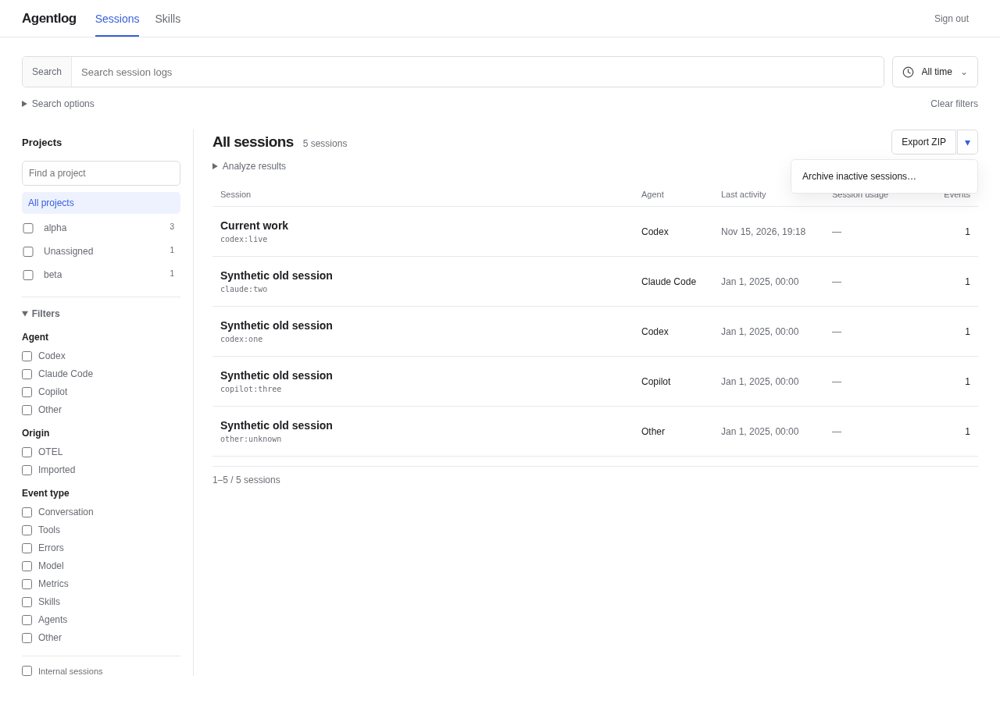
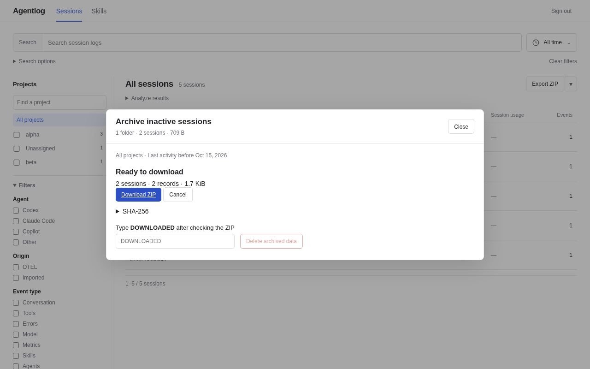

# Export and archive

All file operations start in **Sessions**. No export or archive page is required.

- **Export ZIP** downloads all sessions matching the list’s current search, including pages not currently shown. Internal and subagent-only sessions follow the list’s visibility. A matching session exports its complete history, including replies, tool results and events outside the selected time range.
- The adjacent menu’s **Export entire project** downloads every session in the selected projects, including internal, child and archive-locked sessions. Text, time and ID filters do not limit this action; the current search stays unchanged.
- **Archive inactive sessions…** opens a panel over the list. Select folders containing sessions inactive for over one calendar month, create/download a ZIP, check the file, type **DOWNLOADED**, then delete the archived DB data. The panel covers all projects and shows its own cutoff and selection. Downloading or closing the panel never deletes data. See [archive storage and recovery](archive.md).

Direct exports stream to the browser without retaining an export file on the server or assembling the dataset in browser memory. Counts, membership and event rows share one read snapshot. Interrupted exports are not finalized as successful ZIPs.

JSON/ZIP exports use a separate two-connection read pool, keeping session browsing independent of slow downloads. Up to two direct exports run concurrently; additional requests return HTTP 503 with `Retry-After`. Downloads have no overall duration limit, but a blocked client write times out after 30 seconds. Active export snapshots can retain WAL pages until completion.

Direct-export ZIP contents:

- `manifest.json`: format/version, creation time, filters and session/record counts.
- `events.jsonl`: each original collector event with its ID, session, parent, source, origin, timestamps and complete OTLP `raw` document. Imported and OTEL counterparts remain separate originals.

The inactive-session archive retains its resumable job, per-session ZIP layout, checksum, download confirmation and deletion protection. Closing and reopening the panel resumes viewing the current job; no periodic refresh is used. Source files stay in place.

## API

- Preview: `GET /api/export/sessions?project=…&q=…`
- Download: `GET /api/export/download?project=…&q=…`

Both accept session search filters. API defaults include internal, child and archive-locked sessions. To match the visible list, pass `diagnostics=0` (or `1` when enabled), `include_children=0` and `include_locked=0`. Downloads ignore pagination and export the complete histories of matching sessions. The existing single-session JSON endpoint remains available.

Old `/export` links return to the shared list with their filters. Old `/archive` links open its inactive-session panel.
