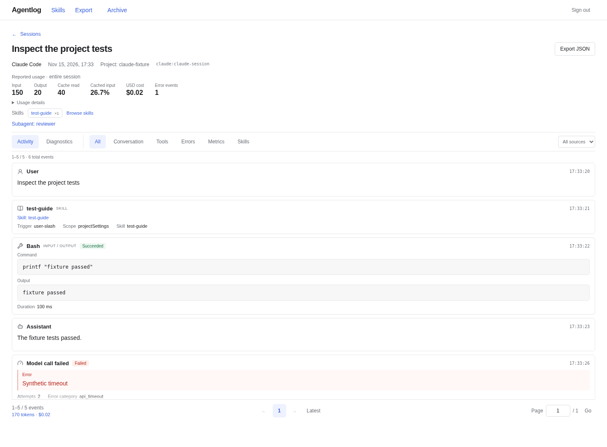
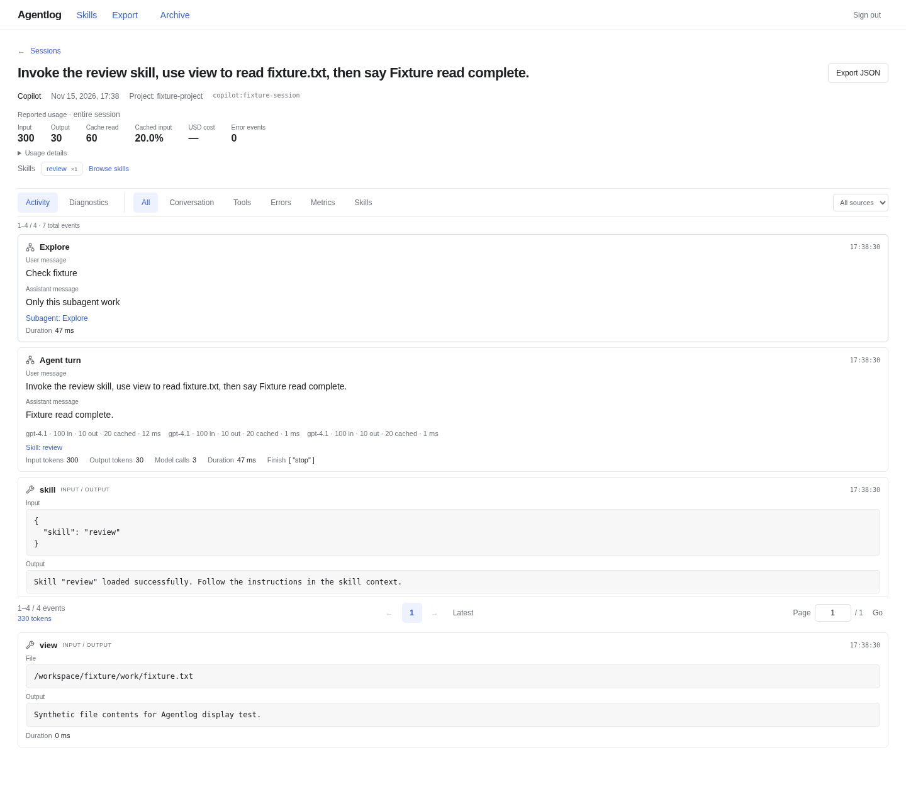

# Claude Code and Copilot display

Agentlog decodes provider-specific conversation, tool and skill fields before rendering cards. Activity shows useful conversation/tool records; Diagnostics retains model calls, permission/audit records, metrics and other internal telemetry. Errors remain visible in Activity.

## Claude Code

The public [Claude Code repository](https://github.com/anthropics/claude-code) contains integrations, plugins and examples, not the CLI implementation. Claude support is based on the official [monitoring reference](https://code.claude.com/docs/en/monitoring-usage), with synthetic records shaped to its documented schema. An authenticated Claude Code session was **not** run for this change.

- `user_prompt` / `assistant_response` display the exported text. `<REDACTED>` becomes “Content not exported” and does not become the session title. `message.uuid` correlates transcript messages and supports exact-ID search.
- Tool cards decode `tool_input`, `tool_parameters`, commands and paths. `tool.output` span events expose returned `content`, `output` or `diff`; legacy `tool.output` attributes are supported too. A span containing both input and output is presented together, with the original JSON available separately.
- Permission decisions expose the decision/source. API errors show failure, retry count and error category. Subagent completion shows tool-call count, duration and **Final request tokens**; Claude's `total_tokens` is not the whole subagent run and is not added as a usage total.
- `skill_activated` counts explicit invocations, including slash-command and agent-triggered activations. Scope, trigger and plugin are retained. Skill loads and confirmed SKILL.md reads are tracked separately from invocation reports.
- Native input-token fields are labelled **Uncached input** in event details. Session/model-call totals add cache reads and writes to use the inclusive GenAI definition. `request_id` connects the documented request/trace usage identities; report families are selected rather than summed twice.

The [Claude settings example](examples/claude.settings.json) already enables logs, enhanced traces and prompt/response/tool content. Claude's exporter can omit tool output for some tool types or content gates; missing content is not reconstructed.



## Copilot CLI

Copilot **1.0.112** was downloaded from the official [npm platform package](https://www.npmjs.com/package/@github/copilot-linux-x64/v/1.0.112) and executed locally. An isolated custom OpenAI-compatible provider returned synthetic responses; Copilot itself loaded a test skill, read a test file and emitted its file-exporter telemetry. No GitHub login, paid inference or real repository content was used. This verifies the CLI's emitted fields, not a production GitHub model or HTTPS collector connection.

The resulting trace shapes are preserved in `internal/app/testdata/copilot-1.0.112-traces.json`, with stable fixture IDs/paths and system instructions/tool descriptions removed or replaced. The [official OpenTelemetry reference](https://docs.github.com/en/copilot/reference/enterprise-administrators/opentelemetry-reference) supplies the additional documented cases.

- An `invoke_agent` record shows the user message and final assistant response; subordinate `chat` spans appear as attached model-call statistics and remain individually accessible in Diagnostics. The injected leading `<current_datetime>` envelope is excluded from the human title. Child-invocation prompts cannot replace the main session title.
- Tool arguments expose paths/commands. Known `{"content":…}` or text-block output envelopes render as text; unknown structured results keep their fields. Scalar text such as `null`, quoted text and partially JSON-looking output is preserved.
- Skill invocation span events support both observed `gen_ai.skill.name` / `gen_ai.skill.source.uri` and documented `github.copilot.skill.*` attributes. Multiple invocations of one skill inside a span each count once; replay does not increase them. Filters use the nested invocation timestamp, including when the containing span began outside the selected range.
- `gen_ai.agent.id` identifies an agent **definition**, not a runtime instance. Nested invocation previews use session + trace + span ancestry, so two same-name agents remain separate. Older explicit runtime-agent IDs still use the existing indexed preview path. No new sessions are invented for these previews.
- Parent invocation token totals are not summed with the child `chat` totals. The captured example previously reported 600 input tokens and now correctly reports 300, matching the three 100-token provider responses. GenAI inference counters and duration metrics are supported. Cache fields retain their standard inclusive definition.
- Copilot billing multipliers stay separate from USD. AI units use `github.copilot.nano_aiu` from the top-level invocation only, with exact decimal display; nested/chat copies are not counted again.



Unassigned/trace-only telemetry from Claude and Copilot is hidden from normal project/session navigation, just like Codex. **Internal sessions** reveals it. Source files and raw records remain available through the original JSON/export paths.

## Existing databases

Prepared provider presentations and invocation groups are preserved by the [offline migration](storage-migration.md). Normal ingestion updates them transactionally; startup does not reparse historical originals.

## Reproduce

The normal regression test uses the recorded synthetic fixture and requires no CLI download:

```sh
AGENTLOG_BIN=./agentlog python3 scripts/provider_display_test.py
```

`go test ./...` covers provider formats, skill counts/times, token/AIU totals, same-definition subagent isolation and restart behavior.

To recapture telemetry with an installed Copilot CLI:

```sh
COPILOT_BIN=/path/to/copilot python3 scripts/copilot_capture_probe.py --output /tmp/copilot-capture
```

The optional probe writes only its synthetic test files/configuration, uses a loopback mock provider and exits within 45 seconds. It emits the original CLI file-exporter format; that diagnostic format is distinct from OTLP HTTP and the CLI's saved session JSONL. No Copilot executable or new runtime dependency is bundled with Agentlog.
