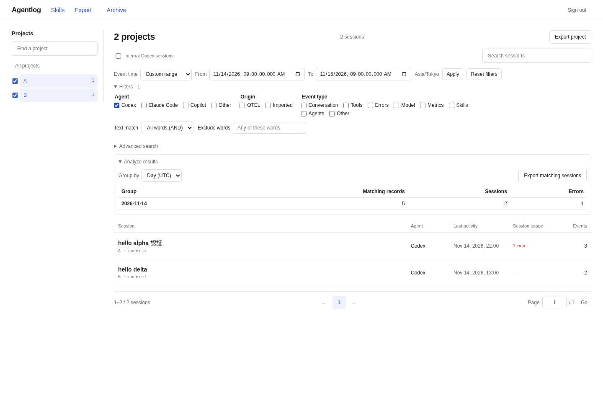
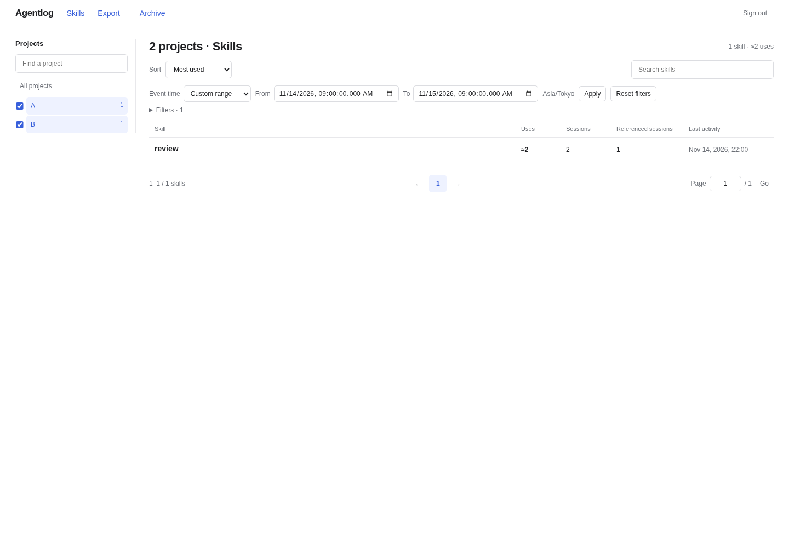

# Search filters

Sessions, Skills and Export share a time range, project selection, agent and origin filters. Use a project name to select one project, or its checkbox to combine several. Within one field, selections are ORed; different fields are ANDed. An empty selection includes all values.

- **Event time**: all time, last 15 minutes/hour/24 hours/7 days/30 days, or an open/closed custom range. Inputs use the browser's named local timezone. From is inclusive and To is exclusive. Presets resolve once when chosen; they do not move in the background. URLs contain exact UTC bounds so a reload/shared URL reproduces the same range.
- **Agent / Origin**: combine agents or OTEL/imported records with checkboxes.
- **Event type** (Sessions/Export): conversation, tools, errors, model, metrics, skills, agents and other events. Overlapping categories are a union, so an error tool event counts once.
- **Text match**: AND (default) or OR over analyzed Japanese/English words. **Exclude words** removes records containing any analyzed exclusion term. These fields stay outside the ordinary text box. Skills instead searches the skill name/plugin/scope/path strings; exclusions remove matching skills.
- **Advanced search** (Sessions/Export): an exact ID field/value, combined with the text and event filters. When combined, the ID and text/time/type/origin must belong to the same stored record.

The session list shows sessions containing a matching record. Time is **event time**, not the session's start or last activity; a continuing session can therefore match an earlier range. Session titles, last activity, event counts and **Session usage** describe the full session. Internal and child sessions remain hidden by default.

**Analyze results** runs only when opened. Group matching stored-record counts, distinct sessions and error counts by UTC day, project, agent or event type. Import/OTEL copies are distinct records here; this is not the merged timeline's logical event count. Up to 100 groups are displayed, with an explicit notice when more exist. An open analysis updates when its conditions change; there is no polling. Analysis errors do not hide the session list.

**Export matching sessions** carries the full filter and root/internal visibility to Export, where they can be changed. Its ZIP contains the complete histories of matching sessions, including records outside the range. **Export project** remains the separate way to export complete projects. Export preview and download use the same predicate. Each download uses one snapshot for its manifest, counts and histories. The manifest records repeated selections as arrays.

Skills counts only evidence **inside** the chosen range/origin and projects. Same-turn invocation deduplication, OTEL precedence and the reference-only session estimate all use that scope: a native report outside the selected range cannot suppress an imported invocation or inferred use inside it. Project/time/agent/origin conditions carry across Skills and its matching-session link; body queries and skill-name queries remain specific to their respective pages.

## Design and API

Parameters are independent URL values rather than a query-language parser:

| Parameter | Meaning |
| --- | --- |
| `project` | Repeat canonical project IDs (`name:shop`, `name:docs`); empty string selects unassigned |
| `source` | Repeat `codex`, `claude`, `copilot`, `other` |
| `origin` | Repeat `otel`, `import` |
| `from`, `to` | RFC3339 with timezone; normalized to nanosecond UTC strings |
| `event_kind` | Repeat event types from the UI; not accepted by Skills |
| `q`, `text_mode` | Search text and `all` / `any` (default `all`) |
| `exclude` | Exclude any matching word |
| `id_key`, `id_value` | Existing exact-ID search; Sessions/Export only |
| `diagnostics` | `1` includes internal Codex sessions in session search |
| `include_children` | Export includes children by default; `0` restricts to roots |

Example: `/api/sessions?project=name:shop&project=name:docs&source=codex&origin=otel&from=2026-11-01T00:00:00Z&to=2026-12-01T00:00:00Z&q=認証&event_kind=error`.

`/api/skills` accepts the shared scope and name search. `/api/search/summary` accepts session filters plus `group=day|project|source|kind`. `/api/projects` retains `q` for the project picker and uses `session_q` for the body query whose matching root-session counts it displays. Counts are independent of the current project selection, so sibling projects remain selectable. Skills' sidebar shows sessions for the time/agent/origin scope, not skill-use counts.

The unfiltered sidebar retains its incremental summary cache. Filtered navigation and analysis reuse `session_catalog`, FTS5 postings, exact-ID indexes and cached event metadata. Range probes use the existing `(session,origin,time,...)` card index; text searches drive from FTS postings and join metadata by primary key. No raw JSON scans, new schema migration, full-history rebuild or initial-load analysis are added.

Validation: `go test ./...` and `scripts/faceted_search_test.py` cover boundaries/timezones, same-record semantics, unions/exclusions, scoped skill deduplication, project counts, URL round trips, native ZIP download, mobile layout and absence of polling. `scripts/search_browser_test.py`, `scripts/skills_browser_test.py` and `scripts/export_browser_test.py` cover the existing flows. All fixtures are synthetic.
