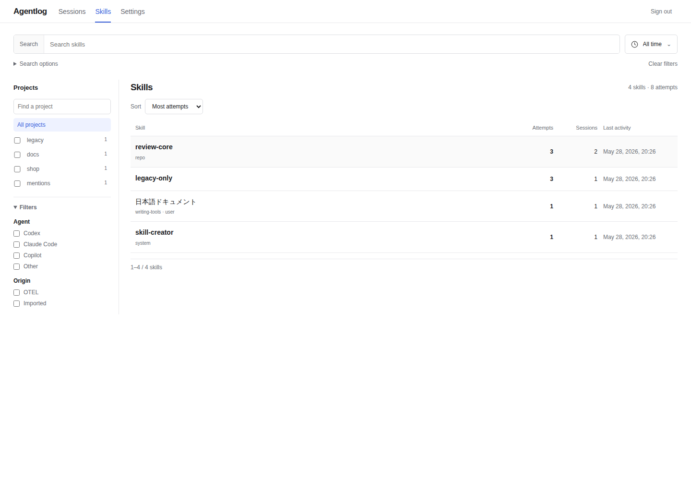

# Skills

Browse `/skills`, select projects and a time range, then click a skill to open its matching sessions. Search names, plugins, scopes or skill paths. Sort by attempts, sessions or recent activity.

**Attempts** counts detected attempts to use a skill, regardless of whether the read succeeded, failed, was cancelled or has no exported result. Explicit invocation reports, skill-read requests and structured skill injections all establish attempts. The catalog and session summaries expose this one metric; they do not grade whether instructions were applied.

Input/output records and imported/OTEL copies count once when explicit call identities establish the relationship. An outer `functions.exec` wrapper and its concrete tool count once when both export the same executor chunk ID for the same skill and executing agent. Repeated calls with distinct identities count separately. Same-turn invocation reports are deduplicated. A unique Copilot report and skill tool connected by an explicit parent/child span count once. Reports, injections and reads without a shared identity remain independent observations. A single tool call contributes at most one attempt per skill.

**Sessions** counts sessions containing attempts. Equal names in different plugins remain separate.

Attempt extraction parses structured file tools, literal shell commands (including `cd … && cat`, multiline commands and shell wrappers), and literal JavaScript tool calls inside `functions.exec`. Dedicated `skills.read` calls are recognized when the package/resource identifies a skill. Code is parsed, never executed. Available-skill lists, ordinary mentions, file writes and in-place edits are excluded. Conditional read requests count as attempts; dynamically computed paths that cannot identify a skill are excluded.

The catalog uses only evidence in the selected time range, projects, agents and origins. Deduplication also uses this scope, so filtering out a concrete tool preserves a visible wrapper attempt. The same filters carry to matching sessions. Original events remain unchanged. The database upgrade rebuilds execution identities only for stored skill-read inputs; later restarts reuse prepared evidence. Normal ingestion updates evidence transactionally. Session detail pages cache summaries by session revision and origin.
