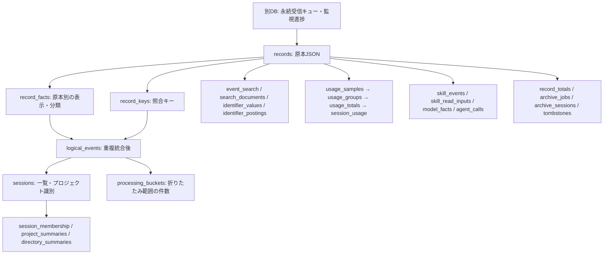

# ストレージ世代2の構成

原本、取り込み元ごとの解析結果、重複統合後の表示を分離しています。公開ID・APIのフィールド名と、DB内の名前は独立しています。

## 旧構成から変えた点

| 対象 | 新しい構成 |
|---|---|
| 23個の旧スキーマ変更と履歴修復 | 完全な新基準スキーマと将来の追加変更。旧DB変換はPythonへ分離 |
| 13個のdirty/pendingテーブル | `work_items(kind,scope,key)`へ統合。型別の読取ビューで参照 |
| 原本・カード・タイムラインの名前 | `records`・`record_facts`・`logical_events`へ役割を明示 |
| プロジェクト識別 | `sessions.project_directory/project_key`へ通常列として保存。UIのpreview JSONから仮想列を毎回評価しない |
| 保存中の解析 | DB非依存の解析・日本語分かち書きはwriterの予約前に実施 |
| トリガーの無変更更新 | 所属・表示分類・トレース祖先の値が変わらなければ依存更新を抑止 |
| 再起動 | 過去ログを全走査せず、未完了の変更だけを回復 |
| 詳細のスキル一覧 | 集合SQLとsession revision・origin単位の上限付きキャッシュ |
| ID検索 | 元の文字列とキー・aliasを辞書化。FTSと共有する整数document IDで参照 |
| 再送 | 原本SHA-256で変更を判定し、解析・日本語分かち書きを省略 |
| 一覧とプロジェクト取得 | 独立して描画。片側の遅延・エラーで他方を隠さない |

物理的なアプリケーションテーブルは53から41へ削減しました。FTS5/R-treeは各1テーブルとして数え、SQLiteが内部生成するshadowテーブルは含めません。12個のpendingビューは、同じwork_itemsへの索引検索です。

件数サマリー、使用量の区間索引、原本別の分類は残しています。削除すると大規模セッションで再集計や原本読み込みが必要になるためです。トークンの計測方式、スキル利用の根拠、アーカイブ後の再取り込み抑止も保持します。

[Pythonによる全データ移行](storage-migration.md) · [更新経路と検証](development.md)
