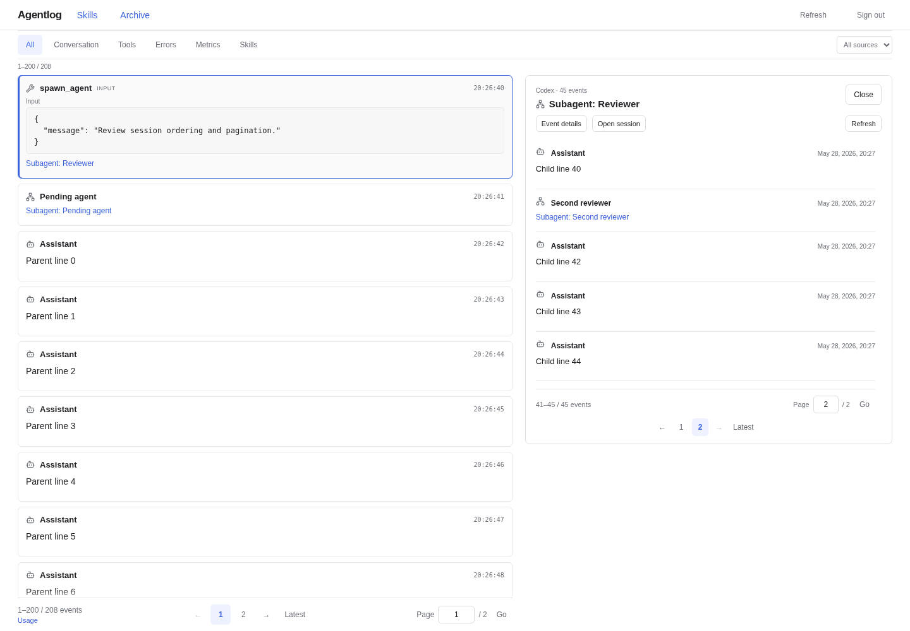

# Subagent logs

Child sessions are hidden from the session list, including search results and pagination totals. Their logs remain accessible from the parent session.

Click **Subagent: …** on a launch card or in the session's related agents to preview its logs without leaving the parent session. The panel opens at the latest entries, supports numbered pages and nested agents, and has **Open session**, **Event details** and **Latest** navigation. Its header stays fixed on desktop and mobile.



Launch/result pairs use explicit tool call IDs, scoped to the session and executing agent. Supported launches include Codex `spawn_agent`, Claude `Task`/`Agent`, Copilot `runSubagent`/`task`, and OTEL `invoke_agent`. Returned agent/session IDs can be JSON, text content blocks, or Claude's `agentId:` result field. Ordinary tool output and prompt text do not create links. Logs that have not been collected show an empty state and can be checked again by reopening the preview.

Codex and Claude use their existing child sessions. Copilot runtime agents stay in their original session; the preview filters by agent attribution and counts paired import/OTEL cards once. Full session navigation still shows that session's complete history.

Preview pages read cached cards, not original payloads. A resumable, bounded upgrade indexes relevant existing records on first start; future changes update the index in the ingestion transaction. Archive deletion removes the corresponding index entries.

```sh
AGENTLOG_BIN=./agentlog python3 scripts/subagents_browser_test.py
```

Tests and screenshots use isolated synthetic data.
