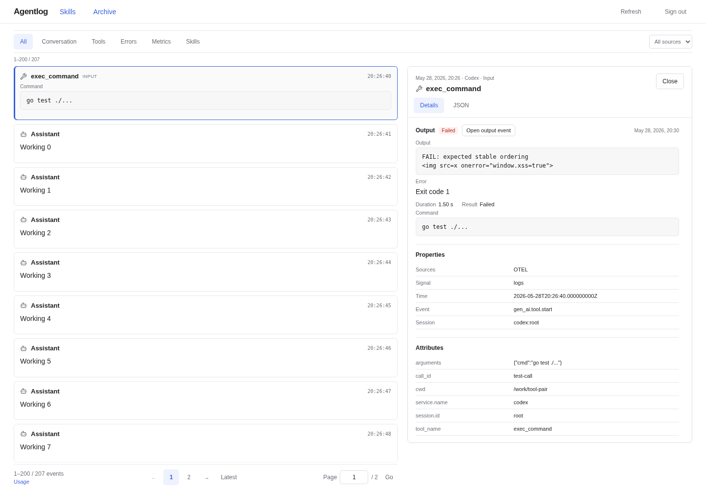

# Tool input and output

Model telemetry cards are labelled **Model call statistics** when tokens, cost or timing are present, **Model stream event** for stream notifications, and **Model API event** otherwise. Imported Codex token reports retain **Token usage**. These labels do not imply that prompt or response text was recorded. Available conversation content appears as **User message**, **Assistant message**, **Model input** or **Model output** in the inspector.

Open a tool card to see the matching input or output at the top of the inspector. **Open output event** and **Open input event** switch between full event details and their original JSON, including when the counterpart is on another timeline page. Closing the inspector returns focus to the original card.



Links use explicit call IDs, scoped to session, provider, executing agent and the selected origin. Paired import/OTEL representations count as one logical candidate. A link is shown only for a unique input and unique output; repeated/conflicting call IDs are not resolved by time proximity. Missing IDs or an uncollected counterpart are identified in the inspector. Events that already contain both sides retain their existing display.

The counterpart preview uses bounded cached cards. Its full original is fetched only when opened. This reuses the existing call-ID index and adds no historical backfill.

Codex events without a conversation ID can appear as `trace:codex:…` or `unassigned:codex`. These unassigned logs and traces are hidden from normal folder/session lists by default. Enable **Unassigned Codex events** to inspect them. Original records remain stored and accessible, and a trace joins a real conversation when explicit trace ownership becomes available. A real conversation lacking working-directory metadata still belongs to **Folder unavailable**.

```sh
AGENTLOG_BIN=./agentlog python3 scripts/tool_pairs_browser_test.py
```

Screenshots and checks use synthetic data.
